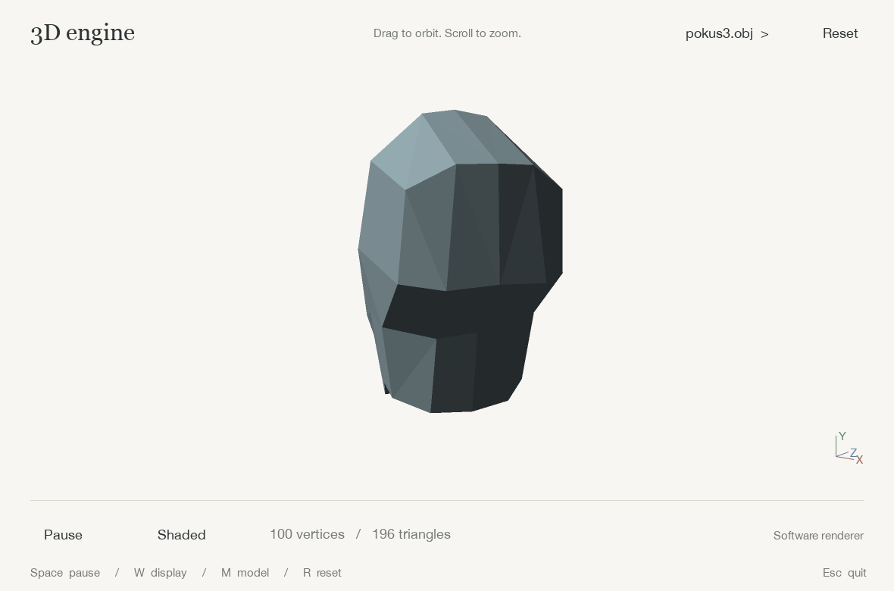

# Python 3D engine

A small software renderer for OBJ meshes. NumPy handles transforms and projection;
Pygame draws flat-shaded triangles. Drag to orbit and scroll to zoom.



## Run

Requires Python 3.10+.

```sh
python -m venv .venv
source .venv/bin/activate       # Windows: .venv\Scripts\activate
python -m pip install -r requirements.txt
python main.py
```

Open another mesh with `python main.py --model objects/cube.obj`. Paths passed to
`--model` are relative to your working directory; the default mesh is found
relative to the application. `main2.py` opens the same viewer.

| Control | Action |
| --- | --- |
| Drag | Orbit the camera |
| Scroll | Zoom |
| Space / Pause | Pause rotation |
| W / Display button | Shaded, edges, or wireframe |
| M / Filename button | Next bundled mesh |
| R / Reset | Fit the model and reset the camera |
| Esc | Quit |

## Rendering

`engine.py` loads OBJ files, transforms vertices in batches, culls back faces,
clips against all six frustum planes, and applies perspective projection. It
sorts visible triangles once per frame using camera-space depth. `main.py` handles
input, lighting colors, and drawing, with 2x supersampling for smoother edges.

The OBJ loader supports vertex positions, slash-separated and negative indices,
and fan triangulation of convex polygons. Meshes are centered and scaled to fit.
Textures, materials, and imported vertex normals are not used. Concave polygons
should be triangulated before export.

Depth uses the painter's algorithm rather than a Z-buffer: intersecting triangles
and cyclic overlap can be drawn in the wrong order. Lighting is flat and
directional, with an ambient term; there are no shadows or reflections.

## Tests and preview

```sh
python -m unittest discover -s tests -v
python main.py --screenshot docs/preview.png
```

Tests cover camera transforms, projection, clipping, OBJ parsing, and headless
interaction. The screenshot command saves a PNG without opening a window.
